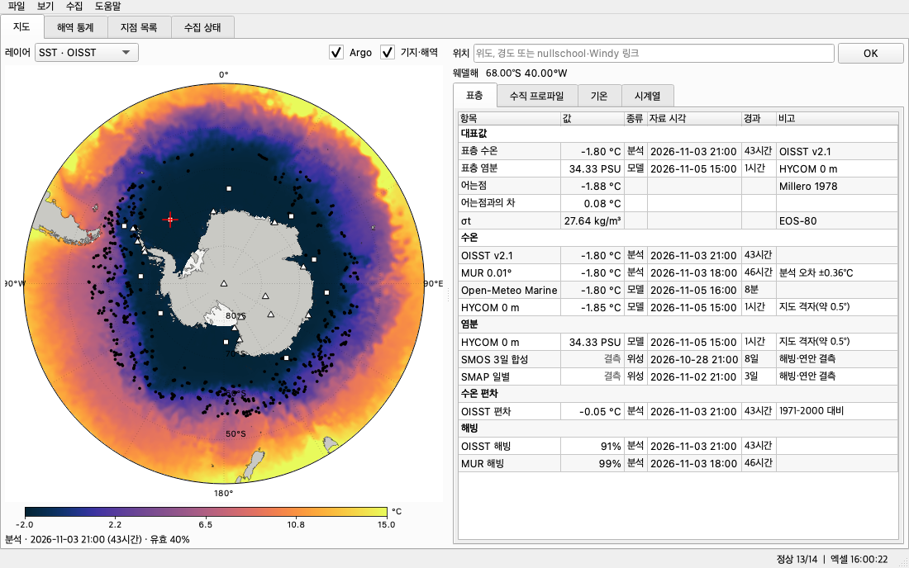
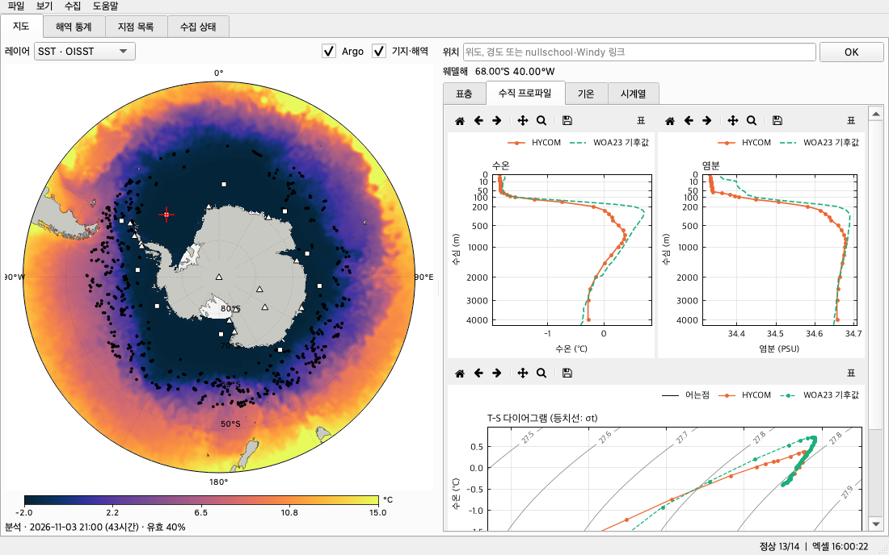
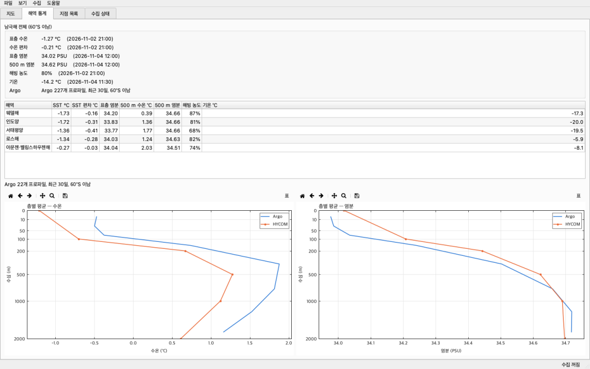
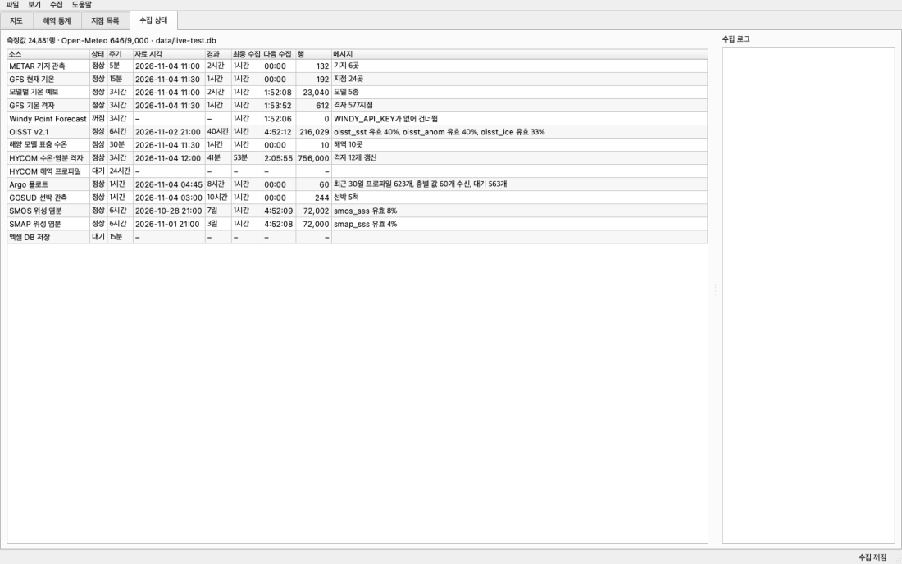
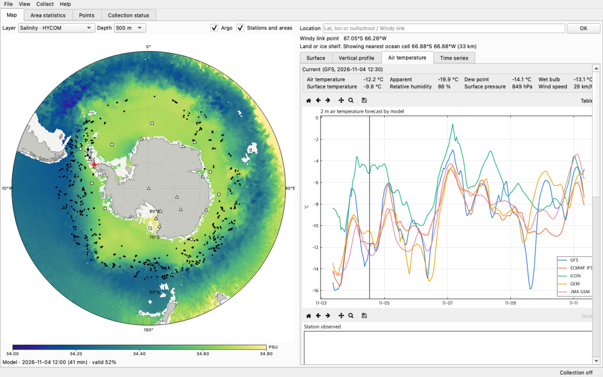
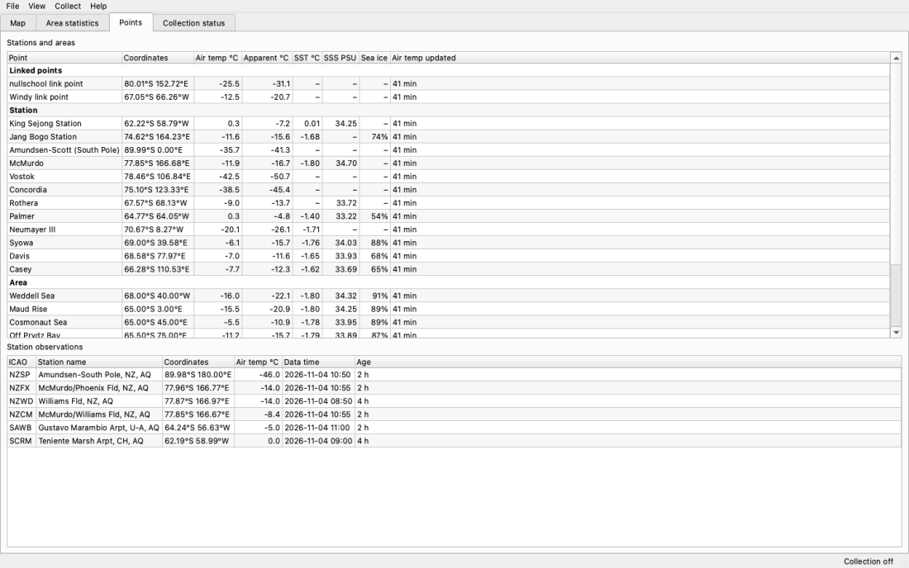

# SUYA — 남극해 수온·염분 모니터 (Antarctic Ocean Monitor)

[](https://github.com/jongsu-king/SUYA/releases/latest)
[](https://github.com/jongsu-king/SUYA/actions/workflows/ci.yml)
[](LICENSE)


[English README](README.md) · [변경 이력](CHANGELOG.md) · [데이터 출처 상세](docs/data-sources.md) · [엑셀 DB 구조](docs/excel-database.md) · [빌드](docs/building.md)

**SUYA**는 남극해의 **수온, 염분, 기온**을 공개 데이터 API에서 **실시간으로 계속 수집**해 컴퓨터에 쌓고, 남극 중심 지도·수직 프로파일·T-S 다이어그램·시계열로
보여 주는 Windows·macOS·Linux 데스크톱 프로그램입니다. 모든 값은 SQLite 데이터베이스에 저장되고 **15분마다 월별 엑셀 파일로도 정리**됩니다.
계정도, 서버도, 파이썬 설치도 필요 없습니다. 설치 파일을 받아 열면 바로 데이터가 들어오기 시작합니다.

## 내려받기

| 운영체제 | 내려받기 | 크기 | 비고 |
|---|---|---|---|
| **Windows 10 / 11** (64비트) | [SUYA-0.1.0-windows-x64-setup.exe](https://github.com/jongsu-king/SUYA/releases/latest/download/SUYA-0.1.0-windows-x64-setup.exe) | ≈ 70 MB | 한국어·영어 설치 마법사. 관리자 권한 없이 설치 가능 |
| **macOS 12 이상** Apple Silicon (M1–M4) | [SUYA-0.1.0-macos-arm64.dmg](https://github.com/jongsu-king/SUYA/releases/latest/download/SUYA-0.1.0-macos-arm64.dmg) | ≈ 64 MB | 응용 프로그램 폴더로 끌어 놓기 |
| **macOS 12 이상** Intel | [SUYA-0.1.0-macos-x86_64.dmg](https://github.com/jongsu-king/SUYA/releases/latest/download/SUYA-0.1.0-macos-x86_64.dmg) | ≈ 70 MB | 응용 프로그램 폴더로 끌어 놓기 |
| **Linux** x86_64 (glibc 2.35 이상, Ubuntu 22.04+) | [SUYA-0.1.0-linux-x86_64.tar.gz](https://github.com/jongsu-king/SUYA/releases/latest/download/SUYA-0.1.0-linux-x86_64.tar.gz) | ≈ 90 MB | 풀고 `./install.sh` |
| 파이썬 3.11 이상이 있는 모든 OS | `pip install git+https://github.com/jongsu-king/SUYA.git` | — | 설치 후 `suya` 실행 |

모든 버전, 체크섬(`SHA256SUMS.txt`), 릴리스 노트: **[Releases 페이지](https://github.com/jongsu-king/SUYA/releases)**.
설치 파일은 [GitHub Actions](.github/workflows/release.yml)가 태그된 소스에서 빌드합니다. 코드 서명은 없습니다([처음 실행 경고](#2-2-처음-실행-때-나오는-경고) 참고).

| 지도 · 표층 값 | 수직 프로파일 · T-S 다이어그램 |
|---|---|
|  |  |

| 해역 통계 · 층별 평균 | 수집 상태 · 실시간 로그 |
|---|---|
|  |  |

| 기온 · 모델 비교 (영어 화면) | 지점 목록 · 기지 관측 (영어 화면) |
|---|---|
|  |  |

---

## 목차

1. [왜 만들었나](#1-왜-만들었나)
2. [설치](#2-설치)
3. [처음 실행](#3-처음-실행)
4. [화면 설명 (탭별)](#4-화면-설명-탭별)
5. [수집하는 데이터](#5-수집하는-데이터)
6. [품질 관리 규칙](#6-품질-관리-규칙)
7. [저장: SQLite와 엑셀 데이터베이스](#7-저장-sqlite와-엑셀-데이터베이스)
8. [설정](#8-설정)
9. [명령줄](#9-명령줄)
10. [동작 원리](#10-동작-원리)
11. [네트워크·디스크 사용량과 개인정보](#11-네트워크디스크-사용량과-개인정보)
12. [한계](#12-한계)
13. [문제 해결과 자주 묻는 질문](#13-문제-해결과-자주-묻는-질문)
14. [개발, 테스트, 빌드](#14-개발-테스트-빌드)
15. [저장소 구조](#15-저장소-구조)
16. [앞으로 할 일과 기여](#16-앞으로-할-일과-기여)
17. [인용과 데이터 출처](#17-인용과-데이터-출처)
18. [라이선스와 저작권](#18-라이선스와-저작권)

---

## 1. 왜 만들었나

[earth.nullschool.net](https://earth.nullschool.net/ko/#current/wind/surface/level/orthographic=-196.44,-86.24,479/loc=152.723,-80.012)과
[windy.com](https://www.windy.com/-67.052/-66.257?-68.936,-64.888,5)에서 남극의 수온과 기온을 보다가, 그 뒤에 있는 **원천 데이터를 직접 받아
시간에 따라 쌓고, 두 사이트에 없는 염분까지 함께 보고 싶어서** 만들었습니다.

두 사이트는 데이터를 **그리는 곳**이지 제공하는 곳이 아닙니다.

- **nullschool**은 공개 API가 없고, About 페이지는 데이터 라이선스를 별도 문의로 안내합니다. 대신 nullschool이 그리는 원천인
  **GFS**(기온)와 **OISST**(수온)는 NOAA가 공개하므로 SUYA가 원천에서 직접 받습니다.
- **Windy**는 공식 [Point Forecast API](https://api.windy.com/point-forecast/docs)가 있지만 **수온·염분 항목이 없고**, 무료 키는 값을 섞어서
  돌려줍니다. 웹사이트를 긁어오는 것은 [이용약관 4.6.1](https://account.windy.com/agreements/windy-general-terms-of-use)이 금지하므로
  SUYA는 공식 API만, 사용자가 키를 넣었을 때만 씁니다.

그래서 SUYA는 두 사이트가 쓰는 것과 같은 NOAA·ECMWF 모델에 더해 두 사이트에는 없는 **Argo 플로트 실측, HYCOM 해양모델, 위성 염분,
기지 실측(METAR), 선박 관측, 기후값**을 한곳에 모으고, 시간이 지나도 돌아볼 수 있게 쌓아 둡니다.

쓰임새: 항해나 기지 교대 전에 현장 상황 지켜보기, 수업(모든 값 옆에 출처가 붙어 있음), 남극해 염분의 개인 시계열 만들기, 또는 두 번째 모니터에 띄워 두는 남극 현황판.

## 2. 설치

### 2-1. 설치 파일 (권장)

| OS | 순서 |
|---|---|
| **Windows** | `SUYA-<버전>-windows-x64-setup.exe` 실행. *현재 사용자만*(관리자 권한 불필요) 또는 *모든 사용자* 선택. 시작 메뉴에 "SUYA"가 생깁니다. 제거는 *설정 → 앱*. |
| **macOS** | `.dmg`를 열고 **SUYA**를 *응용 프로그램*으로 끌어 놓은 뒤 디스크 이미지를 추출합니다. 제거는 앱을 휴지통으로. |
| **Linux** | `tar xzf SUYA-<버전>-linux-x86_64.tar.gz && cd SUYA-<버전>-linux-x86_64 && ./install.sh`. `~/.local/opt/suya`에 설치, `~/.local/bin/suya` 링크, 메뉴 항목 등록. 제거는 그 셋을 지우면 됩니다. |

**업데이트**: 새 버전을 그 위에 설치하면 됩니다. 데이터베이스·설정·엑셀은 사용자 폴더(7장)에 있어 건드리지 않습니다.

### 2-2. 처음 실행 때 나오는 경고

SUYA는 개인 오픈소스 프로젝트라 코드 서명 인증서가 없습니다. 그래서 처음 한 번 운영체제가 경고합니다.

- **Windows SmartScreen**: *추가 정보 → 실행*.
- **macOS Gatekeeper**: 처음 한 번 **앱 우클릭 → 열기 → 열기**. "손상되었기 때문에 열 수 없습니다"라고 나오면 터미널에서
  `xattr -dr com.apple.quarantine /Applications/SUYA.app`을 한 번 실행합니다.
- **Linux**: 경고 없음.

릴리스 페이지의 `SHA256SUMS.txt`로 파일을 검증할 수 있습니다(macOS/Linux `shasum -a 256 <파일>`, Windows `certutil -hashfile <파일> SHA256`).

### 2-3. pip

파이썬 3.11 이상이 있다면:

```bash
pip install git+https://github.com/jongsu-king/SUYA.git
suya
```

Windows에서는 `suya-gui`로 실행하면 콘솔 창 없이 뜹니다.

### 2-4. 소스에서 실행

```bash
git clone https://github.com/jongsu-king/SUYA.git
cd SUYA
python -m venv .venv && source .venv/bin/activate     # Windows: .venv\Scripts\activate
pip install -e ".[dev]"
python -m antarctic_monitor
```

## 3. 처음 실행

1. **언어**를 고릅니다(한국어 / English). `보기 > 언어`에서 언제든 바꿀 수 있고, 창이 다시 열려도 수집은 이어집니다.
2. 창이 뜨면 **바로 수집이 시작**됩니다. 기지 관측·GFS·OISST는 1분 안에, HYCOM 격자와 Argo 층별 자료는 5~15분 뒤에 채워집니다.
   지도에 "이 레이어는 수집 대기 중"이 보이면 그대로 기다리면 됩니다.
3. 따로 설정할 것은 없습니다. Windy 키만 선택 사항입니다(`파일 > 설정`).
4. 창을 닫으면 수집도 멈춥니다. 창 없이 계속 수집하려면 [`suya daemon`](#9-명령줄)을 쓰세요.

프로그램 안의 `도움말 > 사용 설명서`(F1)에 이 문서의 요약이 있고, `도움말 > 라이선스`, `도움말 > 제3자 고지`에서 법적 문서를 볼 수 있습니다.

## 4. 화면 설명 (탭별)

### 지도 탭

| 요소 | 설명 |
|---|---|
| **레이어** | SST·OISST, SST 편차·OISST, 수온·HYCOM, 염분·HYCOM, SSS·SMOS, SSS·SMAP, 해빙 농도·OISST, 기온 2 m·GFS |
| **수심** | HYCOM 두 레이어에서 0 / 100 / 200 / 500 / 1000 / 2000 m |
| **Argo**, **기지·해역** | 표시 켜고 끄기. 검은 점 = 최근 30일 Argo 프로파일, 삼각형 = 기지, 네모 = 해역 대표 지점 |
| 마우스 | 움직이면 상태 표시줄에 좌표와 값. **휠** 확대(최대 12배), **끌기** 이동, **더블클릭** 원래 크기, **클릭** 지점 조회(빨간 십자). 점 위에서 클릭하면 그 플로트·기지를 조회 |
| **위치** 입력 | `-65, -60`처럼 위도, 경도를 넣거나 nullschool·Windy 주소를 그대로 붙여 넣기. 주소에서 좌표만 읽고 그 사이트에 접속하지 않습니다 |
| 색 범례 | cmocean 해양 표준 색: 수온 *thermal*, 염분 *haline*, 편차·기온 *balance*, 해빙 *ice* |
| 설명줄 | 자료 종류, 자료 시각과 경과, 60°S 이남 유효 격자 비율, 범위 밖이라 제거한 값 수 |

육지나 빙붕을 클릭하면 "육지/빙붕. 최근접 해양 격자 … 값 표시"라고 알려 주고 가장 가까운 바다 격자(OISST 0.5° 기준, 2000 km 이내)의 값을 대신 보여 줍니다.
기온은 클릭한 지점 그대로입니다.

### 지점 상세 (오른쪽)

| 탭 | 내용 | 호출하는 소스 |
|---|---|---|
| **표층** | 대표 수온·염분, 어는점, 어는점과의 차, 밀도 σt, 소스별 값 표(값·종류·자료 시각·경과·비고) | OISST, MUR, Open-Meteo Marine, HYCOM(저장된 격자), SMOS, SMAP, 저장된 Argo·GOSUD |
| **수직 프로파일** | 깊이별 수온·염분(Argo 실측·HYCOM 모델·WOA23 기후값, 표층이 잘 보이도록 제곱근 수심축)과 T-S 다이어그램(σt 등치선, 어는점 선) | HYCOM 40층(최대 1분), WOA23, 저장된 Argo |
| **기온** | GFS 현재값 8종, 5개 모델 7일 예보 비교("지금" 선 포함), 400 km 안 가장 가까운 기지의 METAR 48시간, 기압 고도별 기온 1000~10 hPa(GFS·ECMWF) | Open-Meteo, 저장된 METAR, Windy(키 있을 때) |
| **시계열** | 최근 30일 OISST 수온, 위성 염분(SMOS·SMAP), 해빙 농도, ERA5 일별 기온(최저~최고 띠) | OISST, SMOS, SMAP, ERA5 |

모든 그래프 위에는 도구막대가 있습니다: 처음 범위 · 이전 · 다음 · 이동 · 영역 확대 · 그림 저장(PNG/PDF/SVG) · **표**(그려진 숫자).
그래프 위에 마우스를 올리면 그 위치의 값이 나옵니다. 표에서 행을 고르고 **Ctrl+C**(**⌘C**)를 누르면 탭 구분 텍스트로 복사되어 엑셀에 바로 붙습니다.
지점 조회 결과는 위치별로 15~180분 캐시되어 같은 곳을 다시 눌러도 호출이 늘지 않습니다.

### 해역 통계 탭

60°S 이남 전체의 면적 가중 평균(표층 수온·편차·염분, 500 m 염분, 해빙, 기온)과 레이어별 자료 시각, 5개 해역별 표,
층별 평균 수온·염분 그래프(Argo 실측 vs HYCOM 모델). 해역 구분은 Parkinson & Cavalieri의 해빙 섹터를 따릅니다:
웨델해(60°W~20°E), 인도양(20~90°E), 서태평양(90~160°E), 로스해(160°E~130°W), 아문젠·벨링스하우젠해(130~60°W).

### 지점 목록 탭

24개 기본 지점의 최신값: 입력한 두 링크 지점(80.01°S 152.72°E, 67.05°S 66.26°W), 기지 12곳(세종, 장보고, 아문센-스콧, 맥머도, 보스토크, 콩코르디아,
로세라, 파머, 노이마이어 III, 쇼와, 데이비스, 케이시), 해역 10곳(웨델해, 모드 라이즈, 코스모넛해, 프리즈만, 데이비스해, 아델리 해안, 로스해, 아문젠해,
벨링스하우젠해, 드레이크 해협). 아래에는 기지별 최신 METAR 관측. 행을 **더블클릭**하면 지도에서 열립니다.

### 수집 상태 탭

소스별 상태·주기·자료 시각·경과·최종 수집·다음 수집까지 남은 시간·행 수·메시지와, 창을 연 뒤의 모든 수집 로그.

| 상태 | 뜻 |
|---|---|
| 정상 | 새 자료를 받아 저장 |
| 갱신 없음 | 원천에 새 자료가 없음(하루 1값 자료에서는 정상) |
| 오류 | 서버·네트워크 문제. 1분 → 2분 → 4분 … 으로 간격을 늘리며 자동 재시도(주기를 넘지는 않음) |
| 호출 한도 | 무료 한도에 걸림. 1시간 이상 대기 |
| 꺼짐 | 설정 없음(Windy 키 없음) |
| 수집 중 / 대기 | 지금 받는 중 / 아직 한 번도 안 돌았음 |

### 메뉴와 단축키

| 메뉴 | 동작 |
|---|---|
| 파일 > 설정… (Ctrl+,) | Windy API 키·종류, 엑셀 저장 폴더, 데이터베이스 경로(읽기 전용) |
| 파일 > 엑셀 DB 지금 저장 | 15분을 기다리지 않고 바로 엑셀을 다시 씀 |
| 파일 > 엑셀 폴더 열기 / 데이터 폴더 열기 | 탐색기·Finder·파일 관리자로 열기 |
| 파일 > CSV 내보내기 | 측정값 전체 / Argo 전 층 / 현재 지도 레이어 |
| 보기 > 언어 | 한국어 / English |
| 수집 > 지금 전체 수집 (F5), 소스별 수집 | 주기를 기다리지 않고 즉시 수집 |
| 도움말 > 사용 설명서(F1), 데이터 출처, 라이선스, 제3자 고지, 프로그램 정보 | |

## 5. 수집하는 데이터

자동 수집 소스 13개와 지점 조회 시에만 호출하는 소스 3개입니다. 요청 형식·URL·소스별 주의점은 [docs/data-sources.md](docs/data-sources.md).

| ID | 자료 | 제공 | 기본 주기 | 받는 것 | 두 사이트와의 관계 |
|---|---|---|---|---|---|
| `metar` | METAR 기지 관측 | NOAA Aviation Weather Center | 5분 | 남극점(NZSP), 맥머도(NZCM·NZFX·NZWD), 마람비오(SAWB), 프레이(SCRM) 등 기온·이슬점·기압 **실측** | 두 사이트에 없음 |
| `openmeteo_current` | GFS 현재 기온 | NOAA GFS / Open-Meteo | 15분 | 24개 지점의 기온, 체감, 이슬점, 습구, 지표 온도, 습도, 기압, 풍속 | nullschool 기온 레이어와 같은 GFS |
| `openmeteo_forecast` | 모델별 기온 예보 | GFS, ECMWF IFS, ICON, GEM, JMA / Open-Meteo | 3시간 | 24개 지점 7일 시간별 기온 | Windy 기본 모델 ECMWF 포함 |
| `gfs_grid` | GFS 기온 격자 | NOAA GFS / Open-Meteo | 3시간 | 2.5°×10° 격자, 87.5°S~50°S + 남극점(577점) | nullschool 기온 레이어 |
| `oisst` | OISST v2.1 | NOAA NCEI / CoastWatch ERDDAP | 6시간 확인 | 수온·1971–2000 대비 편차·해빙 농도, 0.25°→0.5°, 90°S~40°S | nullschool 수온 레이어 원천 중 하나 |
| `openmeteo_marine` | 해양 모델 표층 수온 | Open-Meteo Marine | 30분 | 해역 10곳. 육지 격자 값은 버림 | 참고값 |
| `hycom_grid` | HYCOM 수온·염분 격자 | 미 해군 ESPC-D-V02 / HYCOM.org | 3시간 | 1/12° 모델을 약 0.48°로 추림, 80°S~40°S, 수심 0·100·200·500·1000·2000 m(12개 격자) | 해빙 아래까지 빈틈없는 유일한 염분 지도 |
| `hycom_profiles` | HYCOM 해역 프로파일 | 위와 같음 | 24시간 | 해역 10곳의 40개 층 | 지점별 깊이 이력 |
| `argo` | Argo 플로트 | Argo GDAC / Ifremer ERDDAP | 1시간 확인 | 최근 30일, 55°S 이남 모든 프로파일 목록 + 층별 값(한 번에 60개, 최신순) | **염분의 기준값** |
| `gosud` | GOSUD 선박 관측 | GOSUD / Ifremer ERDDAP | 1시간 확인 | 최근 30일, 50°S 이남 항해 중 표층 수온·염분 | 항로에 있는 곳만 |
| `smos` | SMOS 위성 염분 | ESA / NOAA CoastWatch | 6시간 확인 | 3일 합성, 0.25°→0.5° | 65°S 이남 대부분 결측 |
| `smap` | SMAP 위성 염분 | NASA / NOAA CoastWatch | 6시간 확인 | 일별, 0.25°→0.5° | 65°S 이남 대부분 결측 |
| `windy` | Windy Point Forecast | Windy.com 공식 API | 3시간 | 키가 있을 때만: 24개 지점의 기온·이슬점·습도(지표~150 hPa)·기압 | 공식 API. 수온·염분 없음 |
| `excel` | 엑셀 DB 저장 | (내부 작업) | 15분 | 새 자료가 있을 때 월별 엑셀 재생성 | — |

지점 조회 시에만: **MUR SST**(NASA JPL, 0.01°, 분석 오차 포함), **World Ocean Atlas 2023**(NOAA, 1500 m까지 월별, 그 아래 연평균 기후값), **ERA5**(ECMWF / Open-Meteo, 일별 평균·최저·최고 기온).

수집하지 않는 것과 이유: nullschool 내부 데이터(공개 API 없음), Windy 웹사이트 내부 주소(약관 금지), Copernicus Marine(로그인 필요), MEOP 해양 포유류 CTD(파일 배포), NSIDC 해빙(OISST·MUR로 대체).

## 6. 품질 관리 규칙

실제로 받아 보면 그대로 쓰면 안 되는 값이 꽤 섞여 있습니다. 아래 규칙은 모두 개발 중에 확인한 사례에서 나왔고, 각각 테스트가 있습니다.

| 규칙 | 이유 |
|---|---|
| **Argo QC 플래그 1·2만** 사용. 보정 모드(A·D)면 `*_adjusted`, 실시간(R)이면 원시값 | 플로트 1902223이 염분 0.014(플래그 4)를 그대로 보냄 |
| Argo 상승 관측(direction A)이 있으면 그것만 사용 | 하강 관측은 센서 지연 때문에 품질이 낮음 |
| 위성 염분 **28~37 PSU** 밖 제거 | SMAP 응답에 0.00과 42.83이 실제로 있었음 |
| 수온 −3~40 °C, 모델·Argo 염분 20~42 PSU 밖 제거 | 물리적으로 불가능한 값 |
| Open-Meteo Marine에서 격자 고도 > 0이면 수온 버림 | 육지 격자에서도 −1.8 °C 같은 값이 내려옴 |
| GOSUD QC 플래그 1·2만 | 남위 59°에서 26 °C(플래그 4)가 있었음 |
| 대표값: **100 km·10일 안의 Argo** 실측 우선, 없으면 수온 OISST → MUR → HYCOM, 염분 HYCOM → SMOS → SMAP | 336 km 떨어진 7일 전 플로트를 대표값으로 쓰면 지도와 어긋남 |
| HYCOM 격자 시각을 기억해 같은 시각이면 다시 받지 않음 | 서버 부하와 호출 수 절약 |
| Argo `data_mode`가 바뀌면 층별 값을 다시 받음 | 몇 달 뒤 나오는 지연 보정 염분이 실시간 값을 대체 |
| 수집 메시지는 언어 중립 형태로 저장 | 언어를 바꿔도 지난 기록이 함께 번역됨 |

파생값: 어는점 Millero(1978), 밀도 σt EOS-80(Millero & Poisson 1981), 압력→수심 Saunders & Fofonoff(1976). UNESCO 1983 검증값으로 테스트합니다.

## 7. 저장: SQLite와 엑셀 데이터베이스

| 운영체제 | 데이터베이스 · 설정 · 로그 | 엑셀 DB (기본) |
|---|---|---|
| Windows | `%APPDATA%\SUYA\` | `문서\SUYA\` |
| macOS | `~/Library/Application Support/SUYA/` | `~/Documents/SUYA/` |
| Linux | `~/.local/share/SUYA/` | `~/Documents/SUYA/` |

### SQLite (`antarctic.db`)

| 표 | 내용 | 기본 키 |
|---|---|---|
| `measurements` | 모든 지점값: `source`, `dataset`, `variable`, `kind`(observation / satellite / analysis / model / forecast / climatology), `lat`, `lon`, `level`, `depth_m`, `pressure_hpa`, `obs_time`, `value`, `unit`, `location_id`, `quality`, `fetched_at` | source, dataset, variable, lat, lon, level, obs_time |
| `grids` | 지도 레이어 스냅샷(gzip JSON: `lats`, `lons`, `values`)과 미리 계산한 통계(평균·최소·최대·유효 비율·백분위·해역 평균) | layer, valid_time |
| `argo_profiles` | 프로파일 목록(위치·모드·QC·표층 수온·염분)과 층별 값 JSON | platform, cycle |
| `runs`, `source_state` | 모든 수집 기록, 소스별 마지막 상태·자료 시각·다음 실행·연속 오류 수 | |
| `kv` | 원천 갱신 토큰, 일일 호출 예산, 엑셀 생성 기준 | |

WAL 모드라 수집이 쓰는 동안에도 화면이 읽습니다. 30일 지난 예보와 레이어당 60개를 넘는 격자 스냅샷은 매일 정리하고, 관측·위성·분석값은 계속 보관합니다.
SUYA가 돌아가는 중에도 파이썬, R, [DB Browser for SQLite](https://sqlitebrowser.org/)로 열 수 있습니다.

### 엑셀 (`antarctic_db_YYYY-MM.xlsx`, `argo_levels_YYYY-MM.xlsx`)

| 시트 | 내용 |
|---|---|
| 정보 | 기간, 생성 시각, 시트별 행 수 |
| 격자평균 | 레이어·시각별 60°S 이남 평균, 최소·최대, 유효 비율, 해역 5곳 평균 |
| 수온염분_해역 | 해역 10곳의 표층 수온·염분·편차·해빙 (OISST, SMOS, SMAP, HYCOM, Marine) |
| 수온염분_수직 | 해역 10곳 HYCOM 40층 수온·염분, 층마다 한 행 |
| Argo_목록 | 프로파일별 시각·위치·모드·QC·표층 수온·염분·최대 수심·층 수 |
| 선박관측 | GOSUD 선박별 시각·위치·수온·염분 |
| 기지기온 | METAR 기지별 기온·이슬점·기압 |
| GFS기온 | 24개 지점 GFS 현재값 8종 |
| 모델예보 | 24개 지점 × 예보 시각 × 5개 모델 |
| Windy | Windy API 값(키 있을 때) |
| 지점조회 | 지도에서 클릭한 임의 지점의 조회 결과 |
| *(두 번째 파일)* Argo층별 | Argo 전 층: 압력, 수심, 수온, 염분 |

엑셀 파일은 **SQLite에서 다시 생성**되며, 임시 파일에 다 쓴 뒤 교체하므로 깨진 파일이 남지 않습니다. 이번 달·지난달과 아직 파일이 없는 달만 다시 쓰고
그 전 달은 고정됩니다. 1,048,576행을 넘으면 `_2`, `_3` 시트로 이어 씁니다. 열 단위 설명: [docs/excel-database.md](docs/excel-database.md).

> 직접 고친 내용은 다음 저장 때 덮어쓰입니다. 분석은 복사본에서 하세요. Windows에서 엑셀로 열어 둔 파일은 교체할 수 없어 다음 주기에 다시 시도합니다.

## 8. 설정

`파일 > 설정` 창에서 바꾸거나, 아래 변수를 **환경 변수**, 실행 폴더의 **`.env`**, 사용자 폴더의 **`settings.env`**(우선순위 순)에 적습니다.
전체 예시는 [.env.example](.env.example).

| 변수 | 기본값 | 설명 |
|---|---|---|
| `MONITOR_LANG` | 처음에 묻고 기억 | `ko` 또는 `en` |
| `WINDY_API_KEY` | 없음 | [api.windy.com/keys](https://api.windy.com/keys)에서 발급. 없으면 Windy만 꺼짐 |
| `WINDY_KEY_TIER` | `testing` | `testing`(무료, 변형값) / `professional` |
| `WINDY_MODELS` | `gfs` | 쉼표 구분. 호출 수 = 24 지점 × 모델 수 |
| `MONITOR_DB_PATH` | 사용자 폴더의 `antarctic.db` | SQLite 경로 |
| `MONITOR_EXCEL_DIR` | `문서/SUYA` | 엑셀 저장 폴더 |
| `MONITOR_INTERVAL_<소스ID 대문자>` | 5장의 주기 | 초 단위, 최소 30. 예: `MONITOR_INTERVAL_HYCOM_GRID=7200` |
| `MONITOR_OPENMETEO_DAILY_BUDGET` | `9000` | Open-Meteo 하루 호출 상한(무료 한도 10,000) |

`settings.env`에는 Windy 키가 들어갈 수 있어 소유자만 읽을 수 있는 권한으로 저장합니다.

## 9. 명령줄

설치 파일로 깔았다면 실행 파일 자체가 같은 명령을 받습니다(Windows `"C:\Program Files\SUYA\SUYA.exe" collect`, macOS `/Applications/SUYA.app/Contents/MacOS/suya collect`).

```bash
suya                              # 창 열기 (기본). --no-collect: 저장된 데이터만 보기
suya --lang en                    # 이번 실행만 영어로
suya daemon                       # 창 없이 계속 수집 (서버·NAS). Ctrl+C로 종료
suya collect                      # 모든 소스를 한 번 수집하고 결과 출력. 실패한 소스가 있으면 종료 코드 1
suya collect --sources argo,oisst
suya excel-sync                   # 엑셀 파일 지금 쓰기. --all: 모든 달, --month 2026-11, --dir <폴더>
suya export measurements --out all.csv [--source argo] [--variable sea_water_salinity] [--since 2026-11-01T00:00:00Z]
suya export argo --out argo.csv
suya export grid --layer hycom_salt_500 --out salt500.csv
suya sources                      # 소스 목록
suya self-test                    # 설치 점검: 창을 화면 밖에 띄워 보고 엑셀을 써 봄
suya --version
```

`daemon`과 창을 같은 데이터베이스로 동시에 돌리지 마세요(둘 다 수집합니다). 다른 컴퓨터에서 모은 데이터를 보려면 `antarctic.db`를 복사해 `--no-collect`로 엽니다.

## 10. 동작 원리

```
      ┌─ collectors/ ──────────────┐      ┌─ engine.py ────────────────┐
      │ metar  openmeteo  erddap   │◄─────┤ 소스마다 asyncio 태스크 하나 │
      │ hycom  argo  gosud  windy  │      │ 주기 · 백오프 · 호출 예산    │
      └────────────┬───────────────┘      └──────────┬─────────────────┘
                   ▼                                  │ 이벤트
            db.py (SQLite, WAL) ─────────────────────►│
                   │                                  ▼
       ┌───────────┴───────────┐            gui/ (PySide6, 별도 스레드)
       ▼                       ▼            지도 · 그래프 · 표 · 상태
  excel.py (별도 프로세스)   pointquery.py (TTL 캐시, 소스 병렬 호출)
  월별 엑셀                   지점 상세
```

- **수집 엔진**: 소스마다 `asyncio` 루프 하나. 실패하면 1분부터 두 배씩 늘려 재시도하되 정해진 주기를 넘지 않고, 429나 예산 초과면 1시간 이상 쉽니다.
  다음 실행 시각을 DB에 저장해 재시작해도 원천 서버를 다시 치지 않습니다.
- **예의 바른 클라이언트**: 호스트별 동시 연결 2~4개, 연결 20초·응답 60~300초 제한, 백오프 3회, 출처를 밝힌 User-Agent(`suya/<버전> (…github.com/jongsu-king/SUYA)`).
- **HYCOM**은 OPeNDAP `.ascii` 부분 요청으로 필요한 격자만 받습니다. tds 호스트가 일부 요청에 500을 돌려줘 ncss 호스트를 먼저 씁니다.
- **ERDDAP**(OISST·SMOS·SMAP·Argo·GOSUD)은 `time[(last)]`로 최신 시각을 먼저 확인하고 이미 받은 시각이면 내려받지 않습니다.
- **지도**는 남극 중심 스테레오 투영. 화면 픽셀마다 역투영해 격자를 이중 선형 보간합니다(유효 가중치가 절반 미만이면 결측). 확대하면 다시 표본을 뽑아 1/12° HYCOM의 세부가 드러납니다.
- **스레드 안전**: 엔진은 작업 스레드의 이벤트 루프에서 돌고 결과는 Qt 시그널로 창에 전달됩니다. 엑셀 쓰기는 별도 프로세스라 창도 수집도 멈추지 않습니다.
- **테스트**는 개발 중 실제로 받은 응답 형태(불량 QC 플래그, 범위 밖 값, 육지 격자, HYCOM ascii 등)를 파서에 넣어 검증하고, 해수 공식을 발표된 검증값과 비교합니다.

## 11. 네트워크·디스크 사용량과 개인정보

**네트워크.** 기본 주기로 하루 약 50~80 MB. 대부분이 HYCOM 격자(12개 × 약 0.5 MB, 3시간마다)이고 OISST·SMOS·SMAP은 각각 하루 1 MB 정도, 나머지는 킬로바이트 단위입니다.
Open-Meteo는 스스로 정한 하루 9,000 호출 상한 안에 머뭅니다(보통 하루 600~1,500 호출). 프로그램을 켜지 않으면 아무 요청도 보내지 않습니다.

**디스크.** 개발 중 측정: 격자 스냅샷 18개가 평균 82 KB(압축), 측정값 25,000행과 Argo 프로파일 600개가 몇 MB에 들어갔습니다. 레이어당 60개 스냅샷만 남기므로
데이터베이스는 몇 주 뒤 100~200 MB 선에서 안정되고, Argo 층별 값은 한 달에 몇 MB씩 늘며 계속 보관됩니다. 엑셀은 한 달에 2~20 MB입니다.

**개인정보.** SUYA는 5장에 적은 데이터 호스트에만 접속하고 좌표와 데이터셋 이름만 보내며, 사용자에 관한 정보는 아무것도 보내지 않습니다.
원격 측정, 업데이트 확인, 계정이 없습니다. Windy 키를 넣으면 로컬 `settings.env`에만 저장됩니다. 로그(`monitor.log`, 2 MB × 3개 순환)에는 수집 결과와 오류만 남습니다.

## 12. 한계

- Windy 무료(testing) 키는 Windy가 **값을 섞고 변형해서** 돌려줍니다. "(변형값)"으로 표시하며 실제 예보로 쓰면 안 됩니다.
- 위성 염분(SMOS·SMAP)은 해빙 아래와 연안에서 결측이고 저온에서 오차가 큽니다. 염분 지도는 HYCOM, 실측은 Argo를 보세요.
- HYCOM은 80°S 이남을 다루지 않습니다. 로스·필히너-론 빙붕 아래는 비어 있습니다.
- OISST·SMOS·SMAP은 하루 1값이고 1~2일 지연됩니다. "경과" 39시간은 정상입니다.
- 지점을 아주 많이 클릭하면 Open-Meteo 일일 상한에 닿을 수 있습니다. UTC 자정에 풀립니다.
- HYCOM 서버가 느리거나 오류를 내는 때가 있어 수직 프로파일은 최대 1분이 걸리고 가끔 다음 시도까지 실패합니다.
- 수치모델·위성·분석값은 추정치이며 어느 제공 기관도 정확도를 보증하지 않습니다. 연구에 쓸 때는 각 원천의 문서와 인용 요건을 따르세요.
- 저장은 모두 UTC, 화면은 현지 시각입니다. 엑셀의 "시각 UTC" 열은 UTC입니다.

## 13. 문제 해결과 자주 묻는 질문

| 증상 | 확인할 것 |
|---|---|
| 지도가 비어 있음 | 첫 수집이 끝날 때까지 몇 분. 수집 상태 탭에 오류가 계속되면 네트워크(방화벽·프록시). 로그 `monitor.log` |
| "HYCOM 오류" / 프로파일이 느림 | HYCOM 서버가 종종 500을 돌려줍니다. 두 호스트를 번갈아 시도하고 다음 주기에 다시 받습니다 |
| 엑셀 저장 실패 "파일이 열려 있어" | Windows에서 엑셀로 열어 둔 파일은 교체할 수 없습니다. 닫으면 다음 주기에 저장됩니다 |
| "호출 한도" | Open-Meteo는 UTC 자정에 풀립니다. Windy testing 키는 하루 500회 |
| 한글이 네모로 보임(Linux) | 한글 글꼴 설치: `sudo apt install fonts-noto-cjk` |
| 처음부터 다시 | 프로그램을 끄고 데이터 폴더의 `antarctic.db`를 지웁니다 |
| macOS "손상되었기 때문에 열 수 없습니다" | 서명이 없어서 나오는 경고: `xattr -dr com.apple.quarantine /Applications/SUYA.app` |
| 창이 너무 작거나 큼 | 창 크기·위치는 사용자별로 기억됩니다. OS의 Qt 설정에서 `SUYA` 항목을 지우세요(Linux `~/.config/SUYA`, macOS `~/Library/Preferences/com.suya.monitor.plist`, Windows 레지스트리 `HKCU\Software\SUYA`) |

**오프라인에서도 되나요?** 창은 열리고 저장된 데이터는 보입니다(`--no-collect`). 새 자료는 들어오지 않습니다.
**북극도 되나요?** 아니요. 지도·해역·지점이 남극해에 맞춰져 있습니다. 수집기는 범용이라 북극판은 새 지도와 지점 목록을 만드는 일입니다.
**소스를 추가할 수 있나요?** 네. 수집기는 `CollectResult`를 돌려주는 비동기 함수 하나이고, `collectors/__init__.py`와 `config.DEFAULT_INTERVALS`에 등록하고 `catalog.py`에 설명을 추가하면 됩니다. 가장 작은 예는 `collectors/gosud.py`.
**왜 웹앱이 아닌가요?** 처음엔 웹앱이었습니다. 데스크톱 프로그램은 데이터가 내 컴퓨터에 남고, 서버가 필요 없고, 기관 방화벽 안에서도 동작합니다.

버그 신고: [Issues](https://github.com/jongsu-king/SUYA/issues) 또는 imjongsu1102@gmail.com. `monitor.log`와 운영체제·버전을 함께 알려 주세요.

## 14. 개발, 테스트, 빌드

```bash
pip install -e ".[dev,build]"
python -m pytest -q                       # 테스트 73개 (네트워크 불필요)
QT_QPA_PLATFORM=offscreen python -m antarctic_monitor self-test
bash packaging/build.sh                   # macOS .dmg / Linux .tar.gz
powershell -File packaging\build.ps1      # Windows setup.exe (Inno Setup 6 필요)
```

`v*` 태그를 푸시하면 [GitHub Actions](.github/workflows/release.yml)가 Windows·macOS(arm64, x86_64)·Linux 설치 파일을 빌드하고 각 OS에서 테스트와 self-test를 돌린 뒤
`SHA256SUMS.txt`와 함께 Release에 올립니다. [ci.yml](.github/workflows/ci.yml)은 push마다 3개 OS × Python 3.11~3.13에서 테스트합니다. 자세한 내용은 [docs/building.md](docs/building.md).

## 15. 저장소 구조

```
antarctic_monitor/        파이썬 패키지 (명령 이름: suya)
├── cli.py                gui, daemon, collect, export, excel-sync, sources, self-test
├── engine.py             스케줄러: 주기, 백오프, 호출 한도, 일정 저장, 이벤트 버스
├── collectors/           데이터 서비스별 모듈 (erddap, hycom, argo, gosud, openmeteo, metar, windy, woa)
├── db.py                 SQLite 저장소
├── excel.py              월별 엑셀 작성
├── pointquery.py         지점 상세: 소스 병렬 호출, TTL 캐시, 육지 → 최근접 바다
├── queries.py            화면용 개요·해역·상태 조회
├── gridutil.py           격자 표본 추출, 면적 가중 통계, 해역 집계
├── seawater.py           EOS-80 어는점·밀도·압력→수심
├── geo.py                좌표 해석(nullschool·Windy 주소), 거리 계산
├── i18n.py               한국어·영어 문자열, 언어 중립 저장 메시지
├── help_text.py          내장 사용 설명서(두 언어)
├── catalog.py, locations.py   소스 설명, 지도 레이어, 24개 지점
├── gui/                  PySide6: app(메인 창), polarmap, charts, panels, dialogs, help, backend
└── data/                 해안선(Natural Earth), cmocean 색표, LICENSE·고지 사본
packaging/                PyInstaller 명세, 아이콘 생성기, Inno Setup 스크립트, 빌드 스크립트, Linux desktop 파일
tests/                    pytest (73개)
docs/                     상세 문서와 화면 캡처
.github/workflows/        ci.yml(테스트), release.yml(설치 파일)
```

## 16. 앞으로 할 일과 기여

생각 중인 것: 계정이 있는 사용자를 위한 Copernicus Marine(GLORYS, OSTIA) · MEOP 물개 CTD 가져오기 · 값이 기준을 넘으면 알림 · 북반구 지도 ·
Windy API가 허용하면 ECMWF 비교 · 기지 추가.

Pull request와 이슈를 환영합니다. 변경은 Qt 앱 안에서(웹 프런트엔드 없음), 두 언어 문자열을 `i18n.py`에 함께 넣고, 소스를 추가할 때 엑셀 동기화가 깨지지 않게 하고,
실제 응답 형태로 파서 테스트를 추가해 주세요. 푸시 전에 `python -m pytest -q`.

## 17. 인용과 데이터 출처

논문이나 보고서에 쓸 때는 **데이터 제공 기관**을 인용하고(어려운 일은 그들이 했습니다) 이 소프트웨어도 함께 인용해 주세요:

> Jongsu Lim and Suyeon Park (2026). *SUYA — Antarctic Ocean Monitor* (version 0.1.0) [Computer software]. https://github.com/jongsu-king/SUYA

기계가 읽는 인용 정보는 [CITATION.cff](CITATION.cff)에 있습니다. GitHub 오른쪽 사이드바의 **Cite this repository** 버튼이 이 파일로
APA·BibTeX 항목을 만들어 줍니다. [.zenodo.json](.zenodo.json)은 [Zenodo](https://zenodo.org/)가 릴리스를 보관할 때 읽는 저자·소속·라이선스
정보입니다. 보관된 릴리스마다 고유 DOI가, 그리고 항상 최신 버전으로 연결되는 개념 DOI가 발급되며, 첫 보관이 끝나는 대로 여기와
`CITATION.cff`, 릴리스 노트에 DOI를 적습니다.

데이터: NOAA NCEI OISST v2.1(Huang et al. 2021) · NOAA NCEP GFS · NOAA Aviation Weather Center METAR · NASA JPL MUR SST v4.1 ·
ESA SMOS와 NASA SMAP 표층 염분(NOAA CoastWatch 배포) · 미 해군연구소 HYCOM ESPC-D-V02 · International Argo Program(doi:10.17882/42182, Ifremer 배포) · GOSUD ·
NOAA World Ocean Atlas 2023 · ECMWF ERA5·IFS, DWD ICON, ECCC GEM, JMA GSM(Open-Meteo, CC BY 4.0) · Natural Earth 해안선 · cmocean 색표(Thyng et al. 2016).
정확한 조건과 필수 표기: [THIRD_PARTY_NOTICES.md](THIRD_PARTY_NOTICES.md).

## 18. 라이선스와 저작권

**Copyright © 2026 임종수(Jongsu Lim) · 박수연(Suyeon Park).**

| | |
|---|---|
| **임종수** (Jongsu Lim) | 개발·관리 · 인천대학교 물리학과 학부연구생, Hybrid Materials & Optoelectronics Laboratory(HMOL) 연구실 · ORCID [0009-0000-3395-1484](https://orcid.org/0009-0000-3395-1484) · imjongsu1102@gmail.com · https://sites.google.com/view/h-mol · https://github.com/jongsu-king |
| **박수연** (Suyeon Park) | 공동 저작자 · 인천대학교 신소재공학과 석사과정, Clean Energy and Materials Lab(CELLMATE) 연구실 · dbsnt110@inu.ac.kr · https://cellmate.inu.ac.kr/ |

[AUTHORS.md](AUTHORS.md)도 참고하세요. SUYA의 소스 코드는 [MIT 라이선스](LICENSE)로 배포합니다.
자유롭게 쓰고 고치고 재배포할 수 있으며, 저작권 표시와 라이선스 전문을 함께 두면 됩니다.

프로그램이 내려받는 **데이터는 각 제공 기관의 것**이며 고유한 이용 조건이 있습니다(17장). 동봉한 해안선(Natural Earth)은 퍼블릭 도메인, 색표(cmocean)는 MIT입니다.
프로그램 안에서는 `도움말 > 라이선스`, `도움말 > 제3자 고지`로 볼 수 있습니다.
