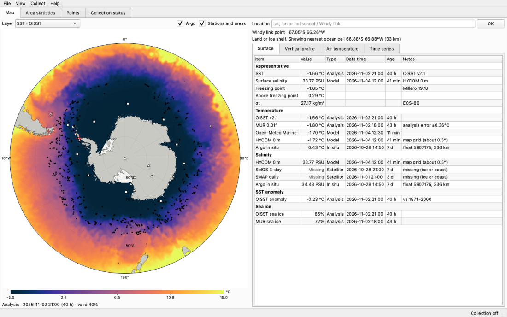
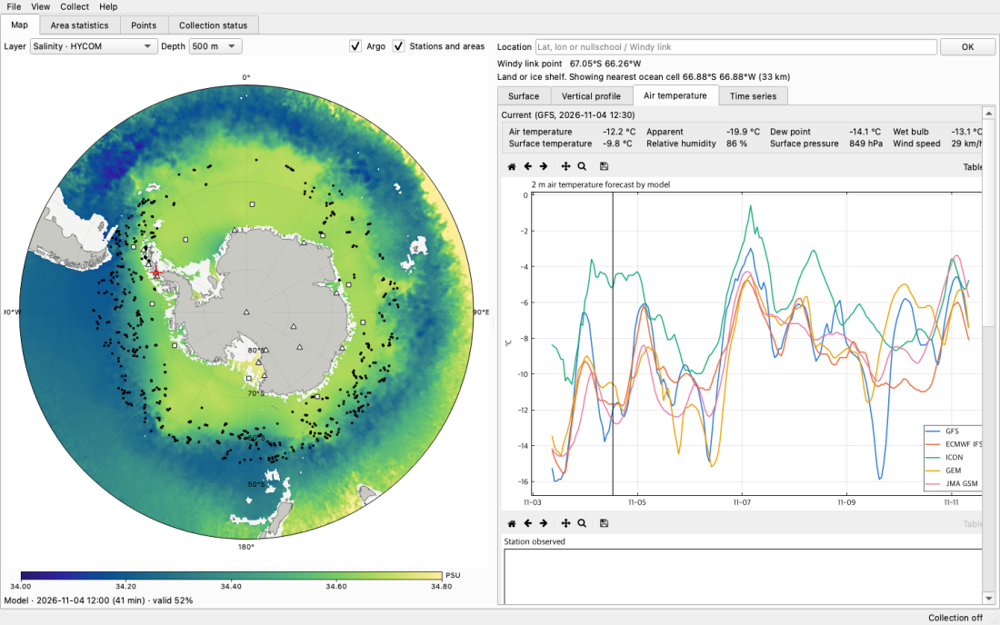
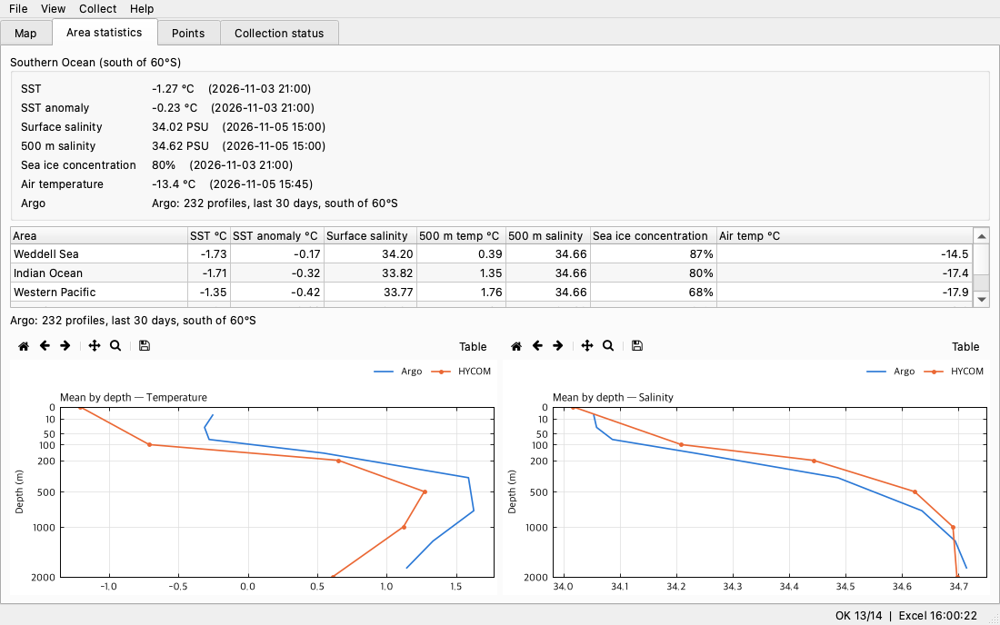
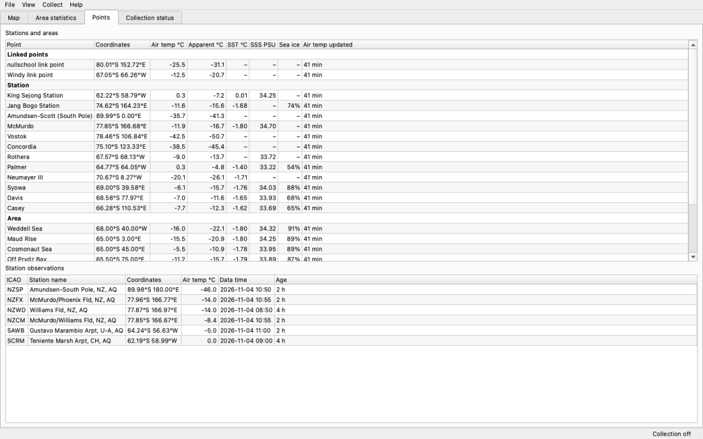
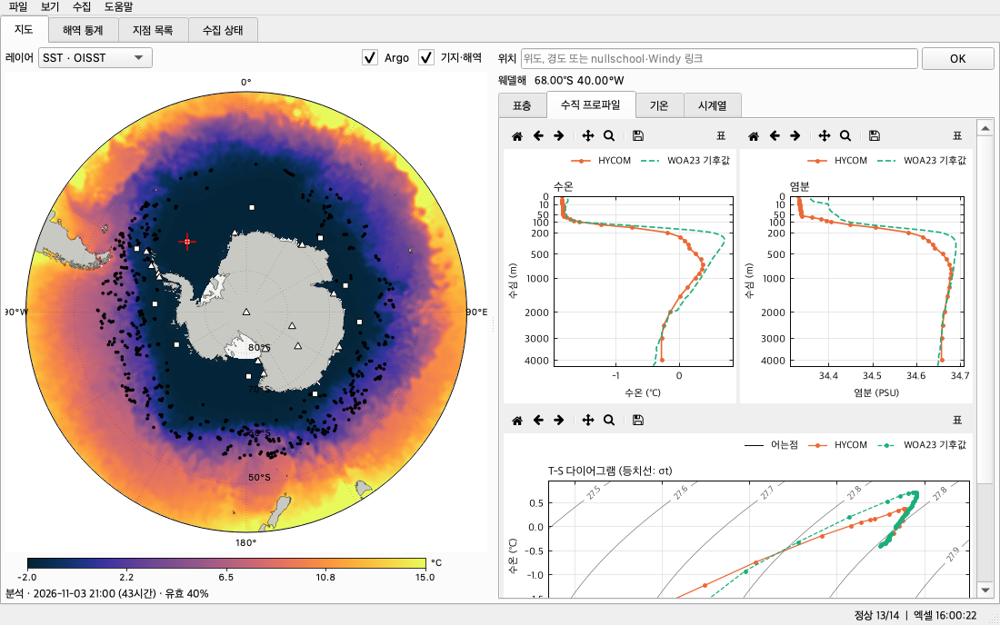
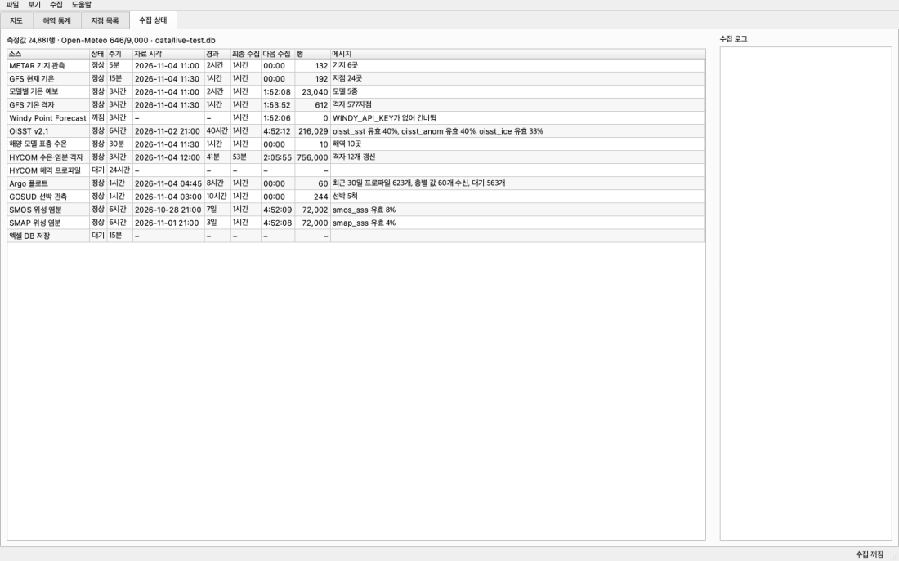

# SUYA — Antarctic Ocean Monitor

[](https://github.com/jongsu-king/SUYA/releases/latest)
[](https://github.com/jongsu-king/SUYA/actions/workflows/ci.yml)
[](LICENSE)
[](https://doi.org/10.5281/zenodo.23937852)


[한국어 README](README.ko.md) · [Changelog](CHANGELOG.md) · [Data sources in detail](docs/data-sources.en.md) · [Excel database layout](docs/excel-database.en.md) · [Building](docs/building.md)

**SUYA** is a desktop program for Windows, macOS and Linux that **continuously collects ocean temperature, salinity and air temperature
for the Southern Ocean** from public data APIs, stores every value in a SQLite database, **rebuilds monthly Excel workbooks every
15 minutes**, and shows it all on a south-polar map with profiles, T-S diagrams and time series. No account, no server, no Python
installation needed: download the installer, open it, and the data starts arriving.

## Download

**Latest release: [SUYA 0.1.1](https://github.com/jongsu-king/SUYA/releases/latest)** — click the button for your operating system:

[-0078d4?style=for-the-badge)](https://github.com/jongsu-king/SUYA/releases/latest/download/SUYA-0.1.1-windows-x64-setup.exe)
[](https://github.com/jongsu-king/SUYA/releases/latest/download/SUYA-0.1.1-macos-arm64.dmg)
[](https://github.com/jongsu-king/SUYA/releases/latest/download/SUYA-0.1.1-macos-x86_64.dmg)
[](https://github.com/jongsu-king/SUYA/releases/latest/download/SUYA-0.1.1-linux-x86_64.tar.gz)

| Operating system | File | Size | Notes |
|---|---|---|---|
| **Windows 10 / 11** (64-bit) | [SUYA-0.1.1-windows-x64-setup.exe](https://github.com/jongsu-king/SUYA/releases/latest/download/SUYA-0.1.1-windows-x64-setup.exe) | ≈ 50 MB | Installer with English/Korean wizard; no admin rights required |
| **macOS 12+** Apple Silicon (M1–M4) | [SUYA-0.1.1-macos-arm64.dmg](https://github.com/jongsu-king/SUYA/releases/latest/download/SUYA-0.1.1-macos-arm64.dmg) | ≈ 60 MB | Drag to Applications. Apple menu → *About This Mac* says "Chip Apple M…" |
| **macOS 12+** Intel | [SUYA-0.1.1-macos-x86_64.dmg](https://github.com/jongsu-king/SUYA/releases/latest/download/SUYA-0.1.1-macos-x86_64.dmg) | ≈ 65 MB | Drag to Applications. *About This Mac* says "Processor … Intel" |
| **Linux** x86_64 (glibc 2.35+, e.g. Ubuntu 22.04+) | [SUYA-0.1.1-linux-x86_64.tar.gz](https://github.com/jongsu-king/SUYA/releases/latest/download/SUYA-0.1.1-linux-x86_64.tar.gz) | ≈ 110 MB | Extract and run `./install.sh` |
| Any OS with Python 3.11+ | `pip install git+https://github.com/jongsu-king/SUYA.git` | — | Then run `suya` |

The same files are listed under **Assets** at the bottom of the [latest release page](https://github.com/jongsu-king/SUYA/releases/latest),
next to `SHA256SUMS.txt` and the release notes; older versions are on the [Releases page](https://github.com/jongsu-king/SUYA/releases).
The builds are produced by [GitHub Actions](.github/workflows/release.yml) from the tagged source. They are not code-signed
(see [First-run warnings](#2-2-first-run-warnings)).

| Map · surface values | Air temperature · model comparison |
|---|---|
|  |  |

| Area statistics · mean profiles | Points · station observations |
|---|---|
|  |  |

| Vertical profile · T-S diagram (Korean UI) | Collection status · live log (Korean UI) |
|---|---|
|  |  |

---

## Contents

1. [Why SUYA exists](#1-why-suya-exists)
2. [Installation](#2-installation)
3. [First start](#3-first-start)
4. [The window, tab by tab](#4-the-window-tab-by-tab)
5. [Data collected](#5-data-collected)
6. [Quality-control rules](#6-quality-control-rules)
7. [Storage: SQLite and the Excel database](#7-storage-sqlite-and-the-excel-database)
8. [Configuration](#8-configuration)
9. [Command line](#9-command-line)
10. [How it works](#10-how-it-works)
11. [Network, disk and privacy](#11-network-disk-and-privacy)
12. [Limitations](#12-limitations)
13. [Troubleshooting and FAQ](#13-troubleshooting-and-faq)
14. [Development, tests and builds](#14-development-tests-and-builds)
15. [Repository layout](#15-repository-layout)
16. [Roadmap and contributing](#16-roadmap-and-contributing)
17. [Citing and data credits](#17-citing-and-data-credits)
18. [License and copyright](#18-license-and-copyright)

---

## 1. Why SUYA exists

This started from two browser tabs, [earth.nullschool.net](https://earth.nullschool.net/#current/wind/surface/level/orthographic=-196.44,-86.24,479/loc=152.723,-80.012)
and [windy.com](https://www.windy.com/-67.052/-66.257?-68.936,-64.888,5), and the wish to **get the data behind the pictures, keep it over
time, and add salinity**, which neither site shows.

Both sites render data; they do not provide it:

- **nullschool** has no public API, and its About page refers data-licensing questions to its owner. The datasets it renders are
  public, though: **GFS** (air temperature) and **OISST** (sea surface temperature) come straight from NOAA, and SUYA reads them from the source.
- **Windy** has an official [Point Forecast API](https://api.windy.com/point-forecast/docs), but it has **no water temperature or salinity**,
  and its free key returns shuffled values. Scraping the website is prohibited by its [terms of use §4.6.1](https://account.windy.com/agreements/windy-general-terms-of-use),
  so SUYA uses the official API only, and only when you enter your own key.

So SUYA collects the same NOAA and ECMWF models the two sites use, plus what they lack: **Argo float measurements, the HYCOM ocean model,
satellite salinity, station observations (METAR), ship data and climatology**, and keeps all of it so you can look back in time.

Typical uses: watching a field site before a cruise or station rotation, teaching (every value has its provenance next to it),
building a personal time series of Southern Ocean salinity, or simply having a live Antarctic dashboard on a second monitor.

## 2. Installation

### 2-1. Installers (recommended)

| OS | Steps |
|---|---|
| **Windows** | Run `SUYA-<version>-windows-x64-setup.exe`. Choose *Install for me only* (no admin rights) or *for all users*. "SUYA" appears in the Start menu. Uninstall from *Settings → Apps*. |
| **macOS** | Open the `.dmg`, drag **SUYA** to *Applications*, eject the disk image. Uninstall by moving the app to the Trash. |
| **Linux** | `tar xzf SUYA-<version>-linux-x86_64.tar.gz && cd SUYA-<version>-linux-x86_64 && ./install.sh`. Installs to `~/.local/opt/suya`, links `~/.local/bin/suya`, adds a menu entry. Uninstall: delete those three things. |

**Updating**: SUYA checks GitHub for a new release 15 seconds after it starts and once a day. By default it asks before downloading;
*Settings ▸ Updates* can turn the check off or make it fully automatic (download, verify the SHA-256, install, restart). Installing a
new version by hand over the old one also works. Your database, settings and workbooks live in your user folders (section 7) and are untouched.

### 2-2. First-run warnings

SUYA is a personal open-source project without a code-signing certificate, so operating systems warn once:

- **Windows SmartScreen**: *More info → Run anyway*.
- **macOS Gatekeeper**: the first time, **right-click the app → Open → Open**. If macOS says the app "is damaged", run
  `xattr -dr com.apple.quarantine /Applications/SUYA.app` in Terminal once.
- **Linux**: no warning.

You can verify a download against `SHA256SUMS.txt` on the release page (`shasum -a 256 <file>` on macOS/Linux, `certutil -hashfile <file> SHA256` on Windows).

### 2-3. pip

With Python 3.11 or newer:

```bash
pip install git+https://github.com/jongsu-king/SUYA.git
suya
```

On Windows, `suya-gui` starts it without a console window.

### 2-4. From source

```bash
git clone https://github.com/jongsu-king/SUYA.git
cd SUYA
python -m venv .venv && source .venv/bin/activate     # Windows: .venv\Scripts\activate
pip install -e ".[dev]"
python -m antarctic_monitor
```

## 3. First start

1. Pick a **language** (English / 한국어). Change it any time under `View > Language`; the window reopens, collection keeps running.
2. Collection **starts immediately**. Station reports, GFS and OISST arrive within a minute; HYCOM grids and Argo profile levels take
   5–15 minutes. "This layer is waiting for collection" on the map means exactly that.
3. Nothing needs configuring. A Windy key is optional (`File > Settings`).
4. Closing the window stops collection. To collect without a window use [`suya daemon`](#9-command-line).

`Help > User guide` (F1) inside the program contains a summary of this document; `Help > License` and `Help > Third-party notices` show the legal texts.

## 4. The window, tab by tab

### Map tab

| Item | Description |
|---|---|
| **Layer** | SST · OISST, SST anomaly · OISST, Temperature · HYCOM, Salinity · HYCOM, SSS · SMOS, SSS · SMAP, Sea ice · OISST, Air temperature 2 m · GFS |
| **Depth** | 0 / 100 / 200 / 500 / 1000 / 2000 m for the two HYCOM layers |
| **Argo**, **Stations and areas** | Marker toggles. Black dots = Argo profiles from the last 30 days, triangles = stations, squares = sea-area points |
| Mouse | Move: coordinates and value in the status bar. **Wheel**: zoom (up to 12×), **drag**: pan, **double-click**: reset, **click**: inspect that point (red cross). Clicking a marker inspects that float or station |
| **Location** box | Type `-65, -60` (lat, lon) or paste a nullschool / Windy URL. Only the coordinates are read; the site is not contacted |
| Colour bar | cmocean oceanographic colormaps: *thermal* (temperature), *haline* (salinity), *balance* (anomaly, air), *ice* |
| Caption | Data kind, data time with age, valid-cell ratio south of 60°S, number of out-of-range values removed |

Clicking land or an ice shelf shows "Land or ice shelf. Showing nearest ocean cell …" and uses the closest ocean cell (on the 0.5° OISST grid,
within 2000 km) for water values. Air temperature is for the clicked point itself.

### Point details (right side)

| Tab | Contents | Sources called |
|---|---|---|
| **Surface** | Representative SST and salinity, freezing point, margin above freezing, density σt, and a table of every source with value, kind, data time, age and notes | OISST, MUR, Open-Meteo Marine, HYCOM (stored grid), SMOS, SMAP, stored Argo and GOSUD |
| **Vertical profile** | Temperature and salinity against depth (Argo in situ, HYCOM model, WOA23 climatology; square-root depth axis so the upper ocean is readable), a T-S diagram with σt contours and the freezing line, and a note with each profile's mixed-layer depth (0.2 °C from the 10 m temperature) | HYCOM 40 levels (up to 2 min), WOA23 (kept in the database once fetched), stored Argo |
| **Air temperature** | Eight GFS current values; 7-day forecasts from five models with a "now" line; 48 h of METAR from the nearest station within 400 km; temperature by pressure level 1000–10 hPa (GFS and ECMWF) | Open-Meteo, stored METAR, Windy (with a key) |
| **Time series** | Last 30 days of OISST SST, satellite salinity (SMOS, SMAP), sea-ice concentration and ERA5 daily air temperature with a min–max band | OISST, SMOS, SMAP, ERA5 |

Every chart has a toolbar: reset view · back · forward · pan · zoom to area · save figure (PNG, PDF, SVG) · **Table** (the plotted numbers).
Hovering shows the values at the cursor. Select rows in any table and press **Ctrl+C** (**⌘C**) to copy tab-separated text straight into Excel.
Point queries are cached for 15–180 minutes per location so clicking the same place twice costs no extra calls.

### Area statistics tab

Area-weighted means south of 60°S (SST, anomaly, surface and 500 m salinity, sea ice, air temperature) with the data time of each layer,
the same for five sectors, and mean temperature/salinity by depth (Argo vs HYCOM). Sectors follow Parkinson & Cavalieri:
Weddell (60°W–20°E), Indian (20–90°E), Western Pacific (90–160°E), Ross (160°E–130°W), Amundsen-Bellingshausen (130–60°W).

### Points tab

Latest values at the 24 built-in points: the two linked points (80.01°S 152.72°E and 67.05°S 66.26°W), 12 stations (King Sejong, Jang Bogo,
Amundsen-Scott, McMurdo, Vostok, Concordia, Rothera, Palmer, Neumayer III, Syowa, Davis, Casey) and 10 sea areas (Weddell Sea, Maud Rise,
Cosmonaut Sea, Prydz Bay, Davis Sea, Adélie Coast, Ross Sea, Amundsen Sea, Bellingshausen Sea, Drake Passage). Below: the latest METAR
observation per station. **Double-click** a row to open it on the map.

### Collection status tab

Per-source status, interval, data time, age, last run, countdown to the next run, row count and message, plus a log of every run since the window opened.

| Status | Meaning |
|---|---|
| OK | New data fetched and stored |
| Unchanged | The source had nothing new (normal for daily products) |
| Error | Server or network problem. Retried after 1, 2, 4 … minutes, never later than the normal interval |
| Rate limited | A free-tier limit was hit; the source pauses for at least an hour |
| Off | Not configured (no Windy key) |
| Running / Waiting | Fetching now / has not run yet |

### Menus and shortcuts

| Menu | Action |
|---|---|
| File > Settings… (Ctrl+,) | Windy API key and tier, Excel folder, update mode, database path (read-only) |
| File > Save Excel database now | Rewrite the workbooks without waiting 15 minutes |
| File > Open Excel folder / Open data folder | In Explorer / Finder / your file manager |
| File > Export CSV | All measurements / all Argo levels / current map layer |
| View > Language | English / 한국어 |
| Collect > Collect all now (F5), Collect source | Fetch immediately |
| Help > User guide (F1), Data sources, License, Third-party notices, About | |

## 5. Data collected

Thirteen scheduled sources plus three that run only on point queries. Request formats, URLs and per-source caveats: [docs/data-sources.en.md](docs/data-sources.en.md).

| ID | Data | Provider | Default interval | What you get | Relation to the two sites |
|---|---|---|---|---|---|
| `metar` | METAR station reports | NOAA Aviation Weather Center | 5 min | **Measured** air temperature, dew point, pressure at South Pole (NZSP), McMurdo (NZCM, NZFX, NZWD), Marambio (SAWB), Frei (SCRM) … | Not on either site |
| `openmeteo_current` | GFS current | NOAA GFS via Open-Meteo | 15 min | Air, apparent, dew point, wet bulb, surface temperature, humidity, pressure, wind at 24 points | Same GFS as nullschool's temperature layer |
| `openmeteo_forecast` | Model forecasts | GFS, ECMWF IFS, ICON, GEM, JMA via Open-Meteo | 3 h | 7-day hourly air temperature at 24 points | Includes ECMWF, Windy's default model |
| `gfs_grid` | GFS air-temperature grid | NOAA GFS via Open-Meteo | 3 h | 2.5° × 10° grid, 87.5°S–50°S plus the pole (577 points) | nullschool temperature layer |
| `oisst` | OISST v2.1 | NOAA NCEI via CoastWatch ERDDAP | checked every 6 h | SST, anomaly vs 1971–2000, sea ice; 0.25° subsampled to 0.5°, 90°S–40°S | A source of nullschool's SST layer |
| `openmeteo_marine` | Ocean-model SST | Open-Meteo Marine | 30 min | SST at the 10 sea areas; land cells discarded | Reference only |
| `hycom_grid` | HYCOM temperature and salinity grids | US Navy ESPC-D-V02 via HYCOM.org | 3 h | 1/12° model subsampled to ≈0.48°, 80°S–40°S, depths 0/100/200/500/1000/2000 m (12 grids) | The only gap-free salinity map, including under ice |
| `hycom_profiles` | HYCOM area profiles | same | 24 h | 40 levels at the 10 sea areas | Depth history per point |
| `argo` | Argo floats | Argo GDAC via Ifremer ERDDAP | checked hourly | Every profile south of 55°S from the last 30 days; level data fetched 60 profiles per run, newest first | **The reference for salinity** |
| `gosud` | GOSUD ship data | GOSUD via Ifremer ERDDAP | checked hourly | Underway SST and salinity south of 50°S, last 30 days | Only along shipping routes |
| `smos` | SMOS salinity | ESA via NOAA CoastWatch | checked every 6 h | 3-day composite, 0.25° → 0.5° | Mostly missing south of 65°S |
| `smap` | SMAP salinity | NASA via NOAA CoastWatch | checked every 6 h | Daily, 0.25° → 0.5° | Mostly missing south of 65°S |
| `windy` | Windy Point Forecast | Windy.com official API | 3 h | With a key only: air temperature, dew point, humidity (surface–150 hPa), pressure at 24 points | Official API; no water temperature or salinity |
| `excel` | Excel database | (internal) | 15 min | Rebuilds the monthly workbooks when data changed | — |

On point queries only: **MUR SST** (NASA JPL, 0.01°, with analysis error), **World Ocean Atlas 2023** (NOAA, monthly climatology to 1500 m, annual below),
**ERA5** (ECMWF via Open-Meteo, daily mean/min/max air temperature).

Not collected, and why: nullschool internals (no public API), Windy website endpoints (prohibited by its terms), Copernicus Marine (login required),
MEOP marine-mammal CTD (file distribution only), NSIDC sea ice (covered by OISST and MUR).

## 6. Quality-control rules

Real responses contain values that must not be used as they are. Each rule below comes from a case seen while building SUYA, and each has a test.

| Rule | Reason |
|---|---|
| **Argo QC flags 1 and 2 only**; `*_adjusted` values in modes A/D, raw values in mode R | Float 1902223 delivered salinity 0.014 with flag 4 |
| Prefer ascending Argo profiles (direction A) | Descending casts suffer from sensor lag |
| Satellite salinity outside **28–37 PSU** dropped | SMAP really returned 0.00 and 42.83 |
| Temperature outside −3…40 °C, model/Argo salinity outside 20–42 PSU dropped | Physically impossible |
| Open-Meteo Marine SST discarded when the cell elevation is > 0 | Land cells still return values like −1.8 °C |
| GOSUD QC flags 1 and 2 only | 26 °C at 59°S with flag 4 was present |
| Representative value: an **Argo profile within 100 km and 10 days** first; otherwise SST OISST → MUR → HYCOM, salinity HYCOM → SMOS → SMAP | A float 336 km away and 7 days old disagreed with the map |
| HYCOM grid time remembered; identical times are not downloaded again | Saves server load and calls |
| Delayed-mode Argo data re-fetched when `data_mode` changes | Adjusted salinity replaces real-time values months later |
| Collection messages stored language-neutral | Switching languages translates past records too |

Derived values: freezing point Millero (1978), density σt from EOS-80 (Millero & Poisson 1981), pressure→depth Saunders & Fofonoff (1976),
all tested against the UNESCO 1983 check values.

## 7. Storage: SQLite and the Excel database

| OS | Database, settings, log | Excel database (default) |
|---|---|---|
| Windows | `%APPDATA%\SUYA\` | `Documents\SUYA\` |
| macOS | `~/Library/Application Support/SUYA/` | `~/Documents/SUYA/` |
| Linux | `~/.local/share/SUYA/` | `~/Documents/SUYA/` |

Besides the database, the data folder holds `settings.env` (settings), `monitor.log` (2 MB × 3, rotated), `crash.log` (written only
when the program crashes natively; empty otherwise), `suya.lock` (keeps a second copy from starting; a lock left behind by a crash is
ignored), `matplotlib/` (font cache, installer builds only) and, while an update is being downloaded, `updates/` (deleted at the next start).

### SQLite (`antarctic.db`)

| Table | Contents | Primary key |
|---|---|---|
| `measurements` | Every point value: `source`, `dataset`, `variable`, `kind` (observation / satellite / analysis / model / forecast / climatology), `lat`, `lon`, `level`, `depth_m`, `pressure_hpa`, `obs_time`, `value`, `unit`, `location_id`, `quality`, `fetched_at` | source, dataset, variable, lat, lon, level, obs_time |
| `grids` | Map-layer snapshots as gzip JSON (`lats`, `lons`, `values`) plus precomputed statistics (mean, min, max, coverage, percentiles, sector means) | layer, valid_time |
| `argo_profiles` | Profile listing (position, mode, QC, surface T/S) and the level data as JSON | platform, cycle |
| `runs`, `source_state` | Every collection run; per-source last status, data time, next run, consecutive errors | |
| `kv` | Source update tokens, daily call budgets, Excel stamp | |

WAL mode, so the GUI reads while collectors write. Forecasts older than 30 days and grid snapshots beyond 60 per layer are pruned daily;
observations, satellite and analysis values are kept forever. Open it with Python, R or [DB Browser for SQLite](https://sqlitebrowser.org/)
while SUYA is running.

### Excel (`antarctic_db_YYYY-MM.xlsx`, `argo_levels_YYYY-MM.xlsx`)

| Sheet | Contents |
|---|---|
| Info | Period, creation time, rows per sheet |
| Grid means | Per layer and time: mean south of 60°S, min, max, valid ratio, five sector means |
| Water by area | Surface SST, salinity, anomaly and ice at the 10 sea areas (OISST, SMOS, SMAP, HYCOM, Marine) |
| Water vertical | HYCOM 40-level temperature and salinity at the 10 areas, one row per level |
| Argo list | Per profile: time, position, mode, QC, surface T/S, max depth, level count |
| Ships | GOSUD per ship: time, position, SST, salinity |
| Stations | METAR per station: air temperature, dew point, pressure |
| GFS air | Eight GFS current values at 24 points |
| Forecasts | 24 points × forecast time × five models |
| Windy | Windy API values (with a key) |
| Point queries | Results for arbitrary points clicked on the map |
| *(second file)* Argo levels | Every Argo level: pressure, depth, temperature, salinity |

Workbooks are **regenerated from SQLite**, written to a temporary file and swapped in, so a crash never leaves a broken file. Only the current
month, the previous month and months without a file are rewritten; older months are frozen. Sheets beyond 1,048,576 rows continue as `_2`, `_3`.
Column-level documentation: [docs/excel-database.en.md](docs/excel-database.en.md).

> Manual edits are overwritten on the next save; analyse a copy. On Windows a workbook open in Excel cannot be replaced; SUYA retries on the next cycle.

## 8. Configuration

Use `File > Settings`, or set these as **environment variables**, in a **`.env`** file in the working directory, or in the per-user **`settings.env`**
(precedence in that order). Full example: [.env.example](.env.example).

| Variable | Default | Meaning |
|---|---|---|
| `MONITOR_LANG` | asked once, then remembered | `en` or `ko` |
| `WINDY_API_KEY` | none | From [api.windy.com/keys](https://api.windy.com/keys). Without it only the Windy source is off |
| `WINDY_KEY_TIER` | `testing` | `testing` (free, altered values) / `professional` |
| `WINDY_MODELS` | `gfs` | Comma separated; calls per run = 24 points × models |
| `MONITOR_DB_PATH` | `antarctic.db` in the user folder | SQLite path |
| `MONITOR_EXCEL_DIR` | `Documents/SUYA` | Excel folder |
| `MONITOR_INTERVAL_<SOURCE_ID>` | see section 5 | Seconds, minimum 30, e.g. `MONITOR_INTERVAL_HYCOM_GRID=7200` |
| `MONITOR_OPENMETEO_DAILY_BUDGET` | `9000` | Daily Open-Meteo call cap (the free limit is 10,000) |
| `MONITOR_UPDATE_MODE` | `notify` | `off` (never check), `notify` (check daily, ask before installing), `auto` (download, install and restart; a 20-second prompt lets you postpone) |

`settings.env` is written with owner-only permissions because it may contain the Windy key.

## 9. Command line

Installed builds accept the same commands through the executable (Windows: `"C:\Program Files\SUYA\SUYA.exe" collect`;
macOS: `/Applications/SUYA.app/Contents/MacOS/suya collect`).

```bash
suya                              # open the window (default). --no-collect: only show stored data
suya --lang ko                    # Korean interface for this run
suya daemon                       # collect continuously without a window (servers, NAS). Ctrl+C to stop
suya collect                      # collect every source once and print the result; exit code 1 if any source failed
suya collect --sources argo,oisst
suya excel-sync                   # write the workbooks now. --all: every month, --month 2026-11, --dir <folder>
suya export measurements --out all.csv [--source argo] [--variable sea_water_salinity] [--since 2026-11-01T00:00:00Z]
suya export argo --out argo.csv
suya export grid --layer hycom_salt_500 --out salt500.csv
suya sources                      # list the sources
suya self-test                    # installation check: opens a window off-screen and writes a workbook
suya --version
```

Run either `daemon` or the GUI against one database, not both. To view data collected on another computer, copy `antarctic.db` and open it with `--no-collect`.

## 10. How it works

```
      ┌─ collectors/ ──────────────┐      ┌─ engine.py ────────────────┐
      │ metar  openmeteo  erddap   │◄─────┤ one asyncio task per source │
      │ hycom  argo  gosud  windy  │      │ interval · back-off · budget│
      └────────────┬───────────────┘      └──────────┬─────────────────┘
                   ▼                                  │ events
            db.py (SQLite, WAL) ─────────────────────►│
                   │                                  ▼
       ┌───────────┴───────────┐            gui/ (PySide6, separate thread)
       ▼                       ▼            map · charts · tables · status
  excel.py (child process)  pointquery.py (TTL cache, parallel source calls)
  monthly workbooks         point inspector
```

- **Engine**: one `asyncio` loop per source. On failure it retries after 1 minute, doubling each time but never beyond the normal interval;
  on HTTP 429 or budget exhaustion it pauses for at least an hour. The next run time is persisted, so a restart does not hammer the servers.
- **Polite client**: 2–4 concurrent connections per host, 20 s connect / 60–300 s read timeouts, three attempts with back-off, an identifying
  User-Agent (`suya/<version> (…github.com/jongsu-king/SUYA)`).
- **HYCOM** is read through OPeNDAP `.ascii` subsets. The `tds` host returns 500 for some requests, so `ncss` is tried first.
- **ERDDAP** sources (OISST, SMOS, SMAP, Argo, GOSUD) ask `time[(last)]` first and skip the download when that time is already stored.
- **Map**: a south-polar stereographic projection; every screen pixel is inverse-projected and the grid bilinearly interpolated (missing when
  less than half the weight is valid). Zooming resamples, so the 1/12° HYCOM detail shows up when you zoom in.
- **GUI thread safety**: the engine runs in a worker thread with its own event loop; results reach the window through Qt signals. Excel writing
  is a child process, so neither the window nor the collectors stall while a workbook is written.
- **Tests** feed the parsers real response shapes seen during development (bad QC flags, out-of-range values, land cells, HYCOM ascii, …) and
  check the seawater formulas against published values.

## 11. Network, disk and privacy

**Network.** Roughly 50–80 MB per day with default intervals, almost all of it the HYCOM grids (12 grids × ≈0.5 MB every 3 h); OISST, SMOS and
SMAP are about 1 MB each per day; everything else is kilobytes. Open-Meteo usage stays under the self-imposed 9,000 calls/day cap
(a normal day uses 600–1,500). No request is made unless you start the program.

**Disk.** Measured during development: 18 grid snapshots average 82 KB each (compressed), 25,000 measurements and 600 Argo profiles fit in a few
megabytes. With pruning (60 snapshots per layer) the database settles around 100–200 MB after a few weeks; Argo levels grow by a few MB per
month and are kept. Excel workbooks are 2–20 MB per month.

**Privacy.** SUYA contacts only the data hosts listed in section 5, sends only coordinates and dataset names, and sends nothing about you.
There is no telemetry and no account. The only other connection is the update check: unless you set it to *off* in Settings,
SUYA asks `api.github.com` once a day for the latest release number (a plain HTTPS request carrying no personal data) and downloads an
installer from `github.com` only when you accept, or when you chose automatic updates; every download is verified against the
release's SHA-256 list. The Windy key, if you enter one, stays in your local `settings.env`. The log file
(`monitor.log`, 2 MB × 3 rotating) records collection results and errors, nothing else.

## 12. Limitations

- Windy's free (*testing*) key returns **shuffled, altered values**. They are labelled "(altered)" and must not be used as forecasts.
- Satellite salinity (SMOS, SMAP) is missing under ice and near coasts and is noisy in cold water. Use the HYCOM layer for a complete map and Argo for measurements.
- HYCOM does not cover south of 80°S; the Ross and Filchner-Ronne ice-shelf cavities are empty.
- OISST, SMOS and SMAP are daily products with a 1–2 day lag; an "age" of 39 hours is normal.
- Clicking a very large number of points can exhaust the Open-Meteo daily cap; it resets at 00:00 UTC.
- The HYCOM server is sometimes slow or returns errors; vertical profiles can take up to a minute and occasionally fail until the next try.
- Model, satellite and analysis values are estimates; no provider guarantees accuracy. For research, follow each source's documentation and citation rules.
- Everything is stored in UTC and displayed in local time; the "Time UTC" columns in Excel are UTC.

## 13. Troubleshooting and FAQ

| Symptom | Check |
|---|---|
| Empty map | Wait a few minutes for the first collection. Persistent errors in the status tab: network (firewall, proxy). See `monitor.log` |
| "HYCOM error" / slow profile | The HYCOM server often answers 500; two hosts are alternated and the next cycle retries |
| Excel save failed "file is open" | A workbook open in Excel cannot be replaced on Windows; close it and the next cycle saves |
| "Rate limited" | Open-Meteo resets at midnight UTC. Windy testing keys allow 500 calls per day |
| Boxes instead of Korean text (Linux) | Install a CJK font: `sudo apt install fonts-noto-cjk` |
| Start over | Quit and delete `antarctic.db` in the data folder |
| macOS "is damaged and can't be opened" | Caused by the missing signature: `xattr -dr com.apple.quarantine /Applications/SUYA.app` |
| Window is tiny / huge | Window size and position are remembered per user; delete the `SUYA` entry in your OS's Qt settings (`~/.config/SUYA` on Linux, `~/Library/Preferences/com.suya.monitor.plist` on macOS, registry `HKCU\Software\SUYA` on Windows) |
| "SUYA is already running" | Another copy holds `suya.lock` in the data folder: a window (look in the Dock or taskbar) or `suya daemon`. Quit it first. A lock left behind by a crash is ignored automatically |
| The program disappears without a message | A native crash leaves a Python traceback in `crash.log` in the data folder; send it together with `monitor.log` |

**Can I use it offline?** The window opens and shows stored data (`--no-collect`), but nothing new arrives.
**Does it work for the Arctic?** No; the map, sectors and points are hard-wired to the Southern Ocean. The collectors are generic, so a northern version would be a new map and point list.
**Can I add a source?** Yes: a collector is one async function returning `CollectResult`, registered in `collectors/__init__.py` and `config.DEFAULT_INTERVALS`, plus a `catalog.py` entry. See `collectors/gosud.py` for the smallest example.
**Why not a web app?** It was one at first. A desktop program keeps the data on your machine, needs no server, and works behind institutional firewalls.

Bug reports: [Issues](https://github.com/jongsu-king/SUYA/issues) or imjongsu1102@gmail.com. Please attach `monitor.log` (and `crash.log` if it is not empty) and say which OS and version you use.

## 14. Development, tests and builds

```bash
pip install -e ".[dev,build]"
python -m pytest -q                       # no network needed
QT_QPA_PLATFORM=offscreen python -m antarctic_monitor self-test
bash packaging/build.sh                   # macOS .dmg / Linux .tar.gz
powershell -File packaging\build.ps1      # Windows setup.exe (needs Inno Setup 6)
```

Pushing a `v*` tag makes [GitHub Actions](.github/workflows/release.yml) build the Windows, macOS (arm64 and x86_64) and Linux installers,
run the tests and the self-test on each, and attach the files with `SHA256SUMS.txt` to the release. [ci.yml](.github/workflows/ci.yml) runs the
tests on every push on Linux and Windows with Python 3.11–3.13 and on macOS with Python 3.12, the version the installers are built with
(GitHub's macOS runners are scarce, so one macOS job keeps the checks from stalling). Details: [docs/building.md](docs/building.md).

## 15. Repository layout

```
antarctic_monitor/        Python package (CLI name: suya)
├── cli.py                commands: gui, daemon, collect, export, excel-sync, sources, self-test
├── engine.py             scheduler: intervals, back-off, rate limits, persisted schedule, event bus
├── collectors/           one module per data service (erddap, hycom, argo, gosud, openmeteo, metar, windy, woa)
├── db.py                 SQLite store
├── excel.py              monthly workbook writer
├── pointquery.py         point inspector: parallel source calls, TTL cache, land → nearest ocean cell
├── queries.py            overview, sector and status queries for the GUI
├── gridutil.py           grid sampling, area-weighted statistics, sector aggregation
├── seawater.py           EOS-80 freezing point, density, pressure→depth
├── geo.py                coordinate parsing (nullschool / Windy URLs), haversine
├── i18n.py               English/Korean strings; language-neutral stored messages
├── help_text.py          built-in user guide (both languages)
├── updates.py            update check and self-update: latest GitHub release, download, SHA-256 check, install, relaunch
├── instance.py           single-instance lock (suya.lock in the data folder)
├── catalog.py, locations.py   source descriptions, map layers, the 24 points
├── gui/                  PySide6: app (main window), polarmap, charts, panels, dialogs, help, backend
└── data/                 coastline (Natural Earth), cmocean tables, LICENSE and notices copies
packaging/                PyInstaller spec, icon generator, Inno Setup script, build scripts, Linux desktop file
tests/                    pytest suite (no network needed)
docs/                     detailed documentation and screenshots
.github/workflows/        ci.yml (tests), release.yml (installers)
```

## 16. Roadmap and contributing

Ideas, in no particular order: Copernicus Marine (GLORYS, OSTIA) for users with an account · MEOP seal CTD import · alerting when a value
crosses a threshold · a northern-hemisphere map · a Windy ECMWF comparison when their API allows it · more stations.

Pull requests and issues are welcome. Keep changes inside the Qt app (no web front end), add both language strings to `i18n.py`, keep the Excel
sync working when adding a source, and add a parser test with a real response shape. Run `python -m pytest -q` before pushing.

## 17. Citing and data credits

If SUYA helps in a publication, cite the **data providers** (they did the hard part) and cite this software:

> Jongsu Lim and Suyeon Park (2026). *SUYA — Antarctic Ocean Monitor* (version 0.1.1) [Computer software]. Zenodo. https://doi.org/10.5281/zenodo.23937852

| DOI | Use it for |
|---|---|
| [10.5281/zenodo.23937852](https://doi.org/10.5281/zenodo.23937852) | **concept DOI** — all versions; always resolves to the latest archived release. Use it unless the exact version matters |
| [10.5281/zenodo.23945830](https://doi.org/10.5281/zenodo.23945830) | version 0.1.1 (this release) |
| [10.5281/zenodo.23937853](https://doi.org/10.5281/zenodo.23937853) | version 0.1.0 |

Every GitHub release is archived automatically on [Zenodo](https://doi.org/10.5281/zenodo.23937852) and receives its own version DOI.
That DOI only exists after the archive is made, so the program and `CITATION.cff` carry the concept DOI.
Machine-readable citation metadata is in [CITATION.cff](CITATION.cff) — GitHub's **Cite this repository** button (right-hand
sidebar) builds APA and BibTeX entries from it — and in [.zenodo.json](.zenodo.json), which Zenodo reads when it archives a release.

```bibtex
@software{lim_park_suya_2026,
  author    = {Lim, Jongsu and Park, Suyeon},
  title     = {{SUYA}: Antarctic ocean temperature, salinity and air temperature monitor},
  version   = {0.1.1},
  year      = {2026},
  month     = {11},
  publisher = {Zenodo},
  doi       = {10.5281/zenodo.23937852},
  url       = {https://doi.org/10.5281/zenodo.23937852}
}
```

Data: NOAA NCEI OISST v2.1 (Huang et al. 2021) · NOAA NCEP GFS · NOAA Aviation Weather Center METAR · NASA JPL MUR SST v4.1 ·
ESA SMOS and NASA SMAP sea-surface salinity via NOAA CoastWatch · US Naval Research Laboratory HYCOM ESPC-D-V02 · International Argo Program
(doi:10.17882/42182) via Ifremer · GOSUD · NOAA World Ocean Atlas 2023 · ECMWF ERA5 and IFS, DWD ICON, ECCC GEM, JMA GSM via Open-Meteo (CC BY 4.0) ·
Natural Earth coastlines · cmocean colormaps (Thyng et al. 2016). Exact terms and required acknowledgements: [THIRD_PARTY_NOTICES.md](THIRD_PARTY_NOTICES.md).

## 18. License and copyright

**Copyright © 2026 Jongsu Lim and Suyeon Park.**

| | |
|---|---|
| **Jongsu Lim** (임종수) | Author and maintainer · Undergraduate Researcher, Hybrid Materials & Optoelectronics Laboratory (HMOL), Department of Physics, Incheon National University · ORCID [0009-0000-3395-1484](https://orcid.org/0009-0000-3395-1484) · imjongsu1102@gmail.com · https://sites.google.com/view/h-mol · https://github.com/jongsu-king |
| **Suyeon Park** (박수연) | Co-author · M.S. Student, Clean Energy and Materials Lab (CELLMATE), Department of Materials Science and Engineering, Incheon National University · dbsnt110@inu.ac.kr · https://cellmate.inu.ac.kr/ |

See also [AUTHORS.md](AUTHORS.md). SUYA's source code is released under the [MIT License](LICENSE): use, modify and
redistribute it freely, keeping the copyright notice and license text.

The **data the program downloads belongs to the publishing organisations** and comes with its own terms (section 17). The bundled coastline
(Natural Earth) is public domain and the bundled colormaps (cmocean) are MIT. Inside the program: `Help > License` and `Help > Third-party notices`.
